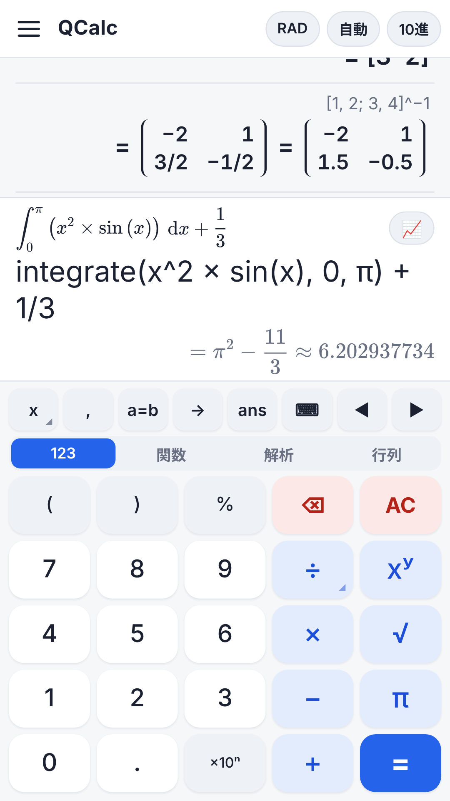
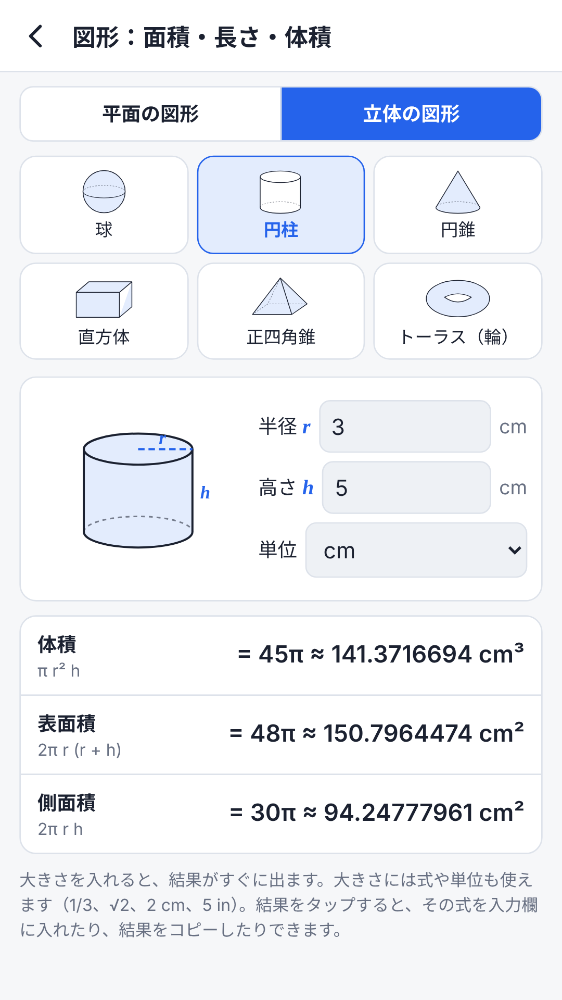
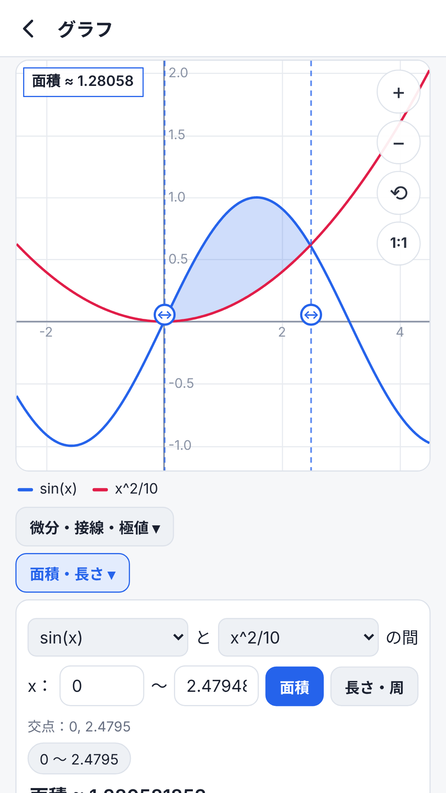

# QCalc

[English](README.md) | **日本語**

式のまま計算できる、Android 用の多機能電卓です。計算には、オープンソースの電卓 [Qalculate!](https://qalculate.github.io/) の計算エンジン **libqalculate 5.13.2** を使っています。QCalc 1.5.0 からは、特殊関数を FLINT の Arb で高い精度のまま速く計算するための小さなパッチ（[patches/](patches/README.md)）を当てています。それ以外は libqalculate のままです。

<p>



</p>

- `60 mph to km/h`、`100 USD to JPY`、`solve(x^2 − 5x + 6 = 0)`、`integrate(x^2 sin(x), 0, pi)` のように、式をそのまま入力して計算できます。
- 入力欄の下に候補を表示：`to` の後には変換先の候補（`5 km to` なら m、mi、ft など。単位のない数なら `hex`、`fraction`、`factors` など）、スマホのキーボードで入力しているときは、入力した文字で始まる関数・単位・定数の名前（日本語の名前でも探せます）
- 単位変換、通貨換算、方程式、微分・積分、行列、複素数、2・8・16 進数、日付、誤差の伝播、最大 200000 桁（20 万桁）の高精度計算。特殊関数（zeta、gamma、erf、ベッセル関数など）は桁数が多くても速く、計算の制限時間は 1 秒〜1 時間で設定できます
- 数式の形に欄が並んだ入力フォーム（結果もすぐに表示）：微分、積分（∫ の上下に上端・下端）、極限、総和、総乗、微分方程式、値の代入、方程式・連立方程式（左辺 = 右辺）、行列（表の形の欄。1 行 1 列〜30 行 30 列。行列式・逆行列・転置・階数・固有値・Ax = b）。空の欄は入力欄では □ になり、「次の欄 ▶」で次の欄に移ります。分数は □/□ で入力します。1.8.0 からは表計算ソフトに近い使い心地で、欄を 1 つずつ確かめて使えない欄にはメッセージを出し、「元に戻す」「やり直す」ができ、閉じたフォームは内容を残し、表計算ソフトの表を行列に貼り付けられます
- 入力中の式を、入力欄の上に数式の形（分数・べき乗・根号・積分など）で表示し、1/6 のような結果も分数の形で表示します（KaTeX）
- キーは「123」「関数」「解析」「行列」の 4 種類。「解析」は微分・積分・極限・総和・微分方程式（`diff`、`integrate`、`limit`、`sum`、`dsolve`）、「行列」は ▦（表の形の入力画面）と行列式・逆行列・転置などのキーです（`[1, 2; 3, 4]` と入力することもできます）。行列の結果は表の形で表示します。x キーの長押しで y・z・t などの文字を選べます。
- 日本の単位（坪・反・寸・尺・間・里・合・升・匁・貫）も使えます（例：`30 坪 to m²`）。libqalculate にはない単位で、QCalc が計算エンジンの起動時に追加しています。行列のトレース `trace()` も同じように追加しています。
- メニューの「図形（面積・体積・長さ）」：大きさを入れるだけで、15 の図形の面積・周の長さ・体積・表面積がすぐに出ます（円・楕円・扇形・長方形・三角形・台形・正多角形、球・円柱・円錐・直方体・正四角錐・トーラス）。図形の絵と公式つきで、結果は正確な値（4π など）と小数の両方を表示し、単位（mm・cm・m・km・in・ft）も選べます
- 2D グラフ（y = f(x)）と 3D グラフ（z = f(x, y) のなめらかでつやのある曲面、指で回転・拡大。球やドーナツの上下のように、閉じて 1 つの立体になる曲面は 1 つの物体として描きます）。2D では導関数・原始関数・接線・零点・極値、曲線の間の面積、曲線の長さ・周の長さ（円・楕円の例つき。関数に実数の値がある部分だけで計算）、3D では偏微分と、いま描いている曲面の体積・表面積（長方形か円の範囲。曲面に実数の値がある部分だけで計算し、ドーナツならその輪の部分。「体積・表面積」を開くとすぐに出て、計測している立体は、濃い色の透明な皮に包まれた薄い色のゼラチンのように見えます。球の例つき。r = 2 なら 32π/3 と 16π）を求められます。どちらのグラフにも、タップするだけで描けるサンプルの列があります（2D は 17 個、3D は 14 個）。2D の面積は「面積・長さ」を開くとすぐに出て、範囲の端は指で動かせ、グラフを動かしても消えません。「1:1」でどの軸の目盛りもそろい、円や球が丸く見えます（3D では、球のように 3 つの範囲が同じくらいなら自動でそろいます）
- 入力フォーム・履歴・グラフが連携します。フォームの 📈 でその計算のグラフ（微分なら接線、定積分なら面積、連立方程式なら直線や平面と解の点、行列なら各行の点）を描き、結果を長押しすると微分・積分・グラフ・方程式に進めます
- 式の例と使い方をアプリ内に収録（タップして試せます）。関数・単位・定数の一覧は日本語でも検索できます。
- 自分で定義する変数と関数、計算履歴、消した式や履歴を「元に戻す」、文字の大きさの変更、配色テーマ（7 色）、ライト／ダークの表示（端末の設定に合わせるか、自分で選ぶ）
- 計算履歴を CSV ファイルに書き出し（Excel でも文字化けしないよう、BOM 付きの UTF-8）
- 画面は英語・日本語・スペイン語・ドイツ語・フランス語・韓国語・繁体字中国語。端末の言語のリストを上から見て、最初に当てはまった言語で始まります（簡体字中国語は飛ばし、どれもなければ英語）。日本語の端末なら日本語です。メニューや設定の「言語 / Language」で切り替えられ、Android 13 以降はシステムの設定（設定 → アプリ → QCalc → 言語）でも選べます（どちらで選んでも同じ言語になります）
- 個人情報を集めません。広告もありません（[プライバシーポリシー](https://hiroshitsu.github.io/qcalc/privacy.html)）。
- 対応端末：Android 7.0 以降、arm64（64 ビット ARM）

QCalc は Qalculate! の公式アプリではなく、Qalculate! の開発者とは関係のない個人が作っています。

## QCalc Pro

QCalc Pro は Google Play での買い切りの購入（1 回限りのアイテム `qcalc_pro`）で、1000 桁を超える有効桁数、3D グラフ、配色テーマ、履歴の書き出しと、今後のバージョンで増える Pro 機能が使えるようになります。そのほかの機能は無料のままです。

- 購入は Google Play Billing Library で行います（`app/src-billing/PlayBilling.java`）。これは Gradle で `qcalc.billing=true` にしたときだけビルドに入ります（`app/build.gradle`）。`build-apk.sh`・`build-aab.sh` では入りません。
- **ライブラリの入っていないビルドでは Pro を買えないため、何も制限しません**（Pro 以前と同じく、すべての機能を無料で使えます）。テスト版（`.debug`）は最初から Pro が有効で、Pro の画面で無効にして、無料版の見え方を確かめられます。
- Pro が始まる前から QCalc を使っている人は、Pro の機能を無料のまま使えます（`Pro.java`）。

## 仕組み

- **画面**：HTML・CSS・JavaScript のページ（`app/assets/`）を WebView で表示しています。Java 側は `QalcNative` という名前の JavaScript インターフェースで呼び出します。
- **Java**（`app/src/`）：`MainActivity` が WebView を持ちます。`Engine` は計算エンジンを子プロセスとして動かし、要求ごとに制限時間を設けます。時間内に答えないエンジンは止めて、起動し直します。`RatesUpdater` は、公式の Qalculate! と同じ取得元から為替レートをダウンロードします。`StateStore` は、履歴・設定・入力中の式をアプリ専用の領域に保存します。`Pro` は QCalc Pro の状態を管理します。
- **計算エンジン**（`bridge/qalc-engine.cc` と libqalculate）：zig でビルドした arm64 の静的な実行ファイルです。インストール時に Android がファイルとして取り出し、アプリから起動できるように、ネイティブライブラリ（`libqalcengine.so`）の形でアプリに入れています。アプリとエンジンは、標準入出力で 1 行に 1 件の JSON をやりとりします（`calc`、`plot`、`plot3d`、`catalog`、`define_var` などの命令）。

## 設計書・マニュアル

設計書一式（PDF、A4）は [design/](design/) にあります。日本語と英語の 2 通りで、内容は同じです。まず概要をご覧ください。

| 文書 | 日本語 | 英語 |
| --- | --- | --- |
| 概要 | [00-overview.pdf](design/00-overview.pdf) | [00-overview-en.pdf](design/00-overview-en.pdf) |
| 1. 要件定義書 | [01-requirements.pdf](design/01-requirements.pdf) | [01-requirements-en.pdf](design/01-requirements-en.pdf) |
| 2. 基本設計書 | [02-basic-design.pdf](design/02-basic-design.pdf) | [02-basic-design-en.pdf](design/02-basic-design-en.pdf) |
| 3. 詳細設計書 | [03-detailed-design.pdf](design/03-detailed-design.pdf) | [03-detailed-design-en.pdf](design/03-detailed-design-en.pdf) |
| 4. 操作マニュアル | [04-user-manual.pdf](design/04-user-manual.pdf) | [04-user-manual-en.pdf](design/04-user-manual-en.pdf) |
| 5. ビルド・保守マニュアル | [05-build-and-maintenance.pdf](design/05-build-and-maintenance.pdf) | [05-build-and-maintenance-en.pdf](design/05-build-and-maintenance-en.pdf) |
| 6. テスト仕様書・結果 | [06-test-specification.pdf](design/06-test-specification.pdf) | [06-test-specification-en.pdf](design/06-test-specification-en.pdf) |

## 中身

| パス | 内容 |
| --- | --- |
| `bridge/qalc-engine.cc` | libqalculate を呼び出す小さなプログラム（1 行 1 件の JSON でアプリとやりとり） |
| `app/AndroidManifest.xml`, `app/src/` | Android 側の Java コード（WebView、エンジンの起動と監視、為替レートの取得、履歴などの保存、QCalc Pro） |
| `app/src-billing/` | Google Play Billing Library を使う QCalc Pro の購入（Gradle で `qcalc.billing=true` のときだけ） |
| `app/res/`, `app/res-debug/` | アプリ名、テーマ、ランチャーのアイコン（`res-debug` はテスト版の名前「QCalc (debug)」） |
| `app/assets/` | 画面（HTML / CSS / JavaScript）。`mathview.js` は式を数式の形に直し、KaTeX（`katex/`）で表示します。`licenses.js` はアプリに組み込んだソフトウェアのライセンス文 |
| `app/jniLibs/arm64-v8a/libqalcengine.so` | ビルド済みの計算エンジン（arm64 の実行ファイル。`build-engine.sh` で作り直せます） |
| `third_party/` | エンジンに組み込んだ libqalculate・GMP・MPFR・FLINT・libxml2 のソース（[説明](third_party/README.md)） |
| `patches/` | QCalc が libqalculate に加えた変更：高い精度の特殊関数を FLINT の Arb で計算する（[説明](patches/README.md)） |
| `fetch-sources.sh` | `third_party/` のソースを `src/` に展開 |
| `build-engine.sh` | エンジンを arm64 向けに静的ビルド（zig を使用。Android NDK は不要） |
| `build-common.sh` | `build-apk.sh` と `build-aab.sh` の共通部分（Android SDK の場所、Java のコンパイルなど） |
| `build-apk.sh` | テスト用 APK（パッケージ名 `io.github.hiroshitsu.qcalc.debug`）を作る |
| `build-aab.sh` | Google Play に出す App Bundle（`.aab`）を作り、アップロード鍵で署名する |
| `make-licenses.py` | `app/assets/licenses.js` を作る（ライブラリの版を変えたとき） |
| `version.properties` | アプリの版（スクリプトと Android Studio の両方がここから読みます） |
| `settings.gradle`, `build.gradle`, `app/build.gradle`, `gradle.properties`, `gradle/wrapper/` | Android Studio（Gradle）用の設定 |
| `keystore.properties.example` | Android Studio で release に署名するときの設定の見本 |
| `icon/` | アイコン：元の絵（カラーの `qcalc-icon.svg` と単色の `qcalc-icon-mono.svg`）、それを描くスクリプト（`draw-icon.py`）、`app/res` の各サイズのアイコンを作るスクリプト（`make-icons.sh`） |
| `store/` | Google Play のストア掲載用の文章（英語 `listing-en.md`、日本語 `listing-ja.md`）と画像（`screenshots-en/`、`screenshots/`） |
| `docs/` | GitHub Pages で公開するページ（紹介ページとプライバシーポリシー） |
| `design/` | 設計書一式（PDF。日本語と英語）：概要、要件定義書、基本設計書、詳細設計書、操作マニュアル、ビルド・保守マニュアル、テスト仕様書・結果 |

## ビルド環境（Ubuntu 24.04 で確認）

```
sudo apt install build-essential autoconf automake libtool intltool autopoint gettext pkg-config \
  aapt dalvik-exchange zipalign apksigner openjdk-17-jdk-headless git curl xz-utils qemu-user-static
pip install ziglang==0.17.1
```

Android SDK の platform ファイルも必要です（このリポジトリには入っていません）。Android Studio の SDK Manager か `sdkmanager "platforms;android-36" "platforms;android-34"` で入れてください。スクリプトは `$ANDROID_HOME`（なければ `~/Android/Sdk`）の下を探します。別の場所にあるときは `ANDROID_JAR`（API 36 の android.jar、Java のコンパイル用）と `AAPT2_JAR`（API 34 の android.jar、Ubuntu の aapt2 は API 35 以降を読めないため）で指定します。

アイコンを作り直すとき（`icon/make-icons.sh`）だけ、`librsvg2-bin` と `imagemagick` も必要です。絵そのものを変えるとき（`icon/draw-icon.py`）は、Python の `fonttools` とフォント Inter も使います。

## ビルド

計算エンジンはビルド済みのものが `app/jniLibs` に入っているので、画面や Java だけを直すときはエンジンのビルドは不要です。

```
./fetch-sources.sh     # third_party/ のソースを src/ に展開
./build-engine.sh      # libqalculate などを arm64 向けにビルドし、エンジンを app/jniLibs にコピー
./build-apk.sh         # テスト用 APK：out/QCalc-<版>-debug.apk
./build-aab.sh         # Google Play 用：out/QCalc-<版>.aab
```

- テスト用 APK は `io.github.hiroshitsu.qcalc.debug`・「QCalc (debug)」という別アプリとして入るので、Google Play 版と並べて使えます。署名にはテスト用の鍵 `signing/qcalc-debug.keystore`（初回に自動で作成）を使います。
- Google Play に新しい版を出すときは、`version.properties` の `VERSION_CODE` を必ず前より大きくしてください。

エンジンの動作確認（任意。PC 上で arm64 を模擬実行）：

```
echo '{"id":1,"cmd":"calc","expr":"integrate(x^2 sin(x), 0, pi)"}' | QALCULATE_USER_DIR=/tmp/q qemu-aarch64-static bridge/qalc-engine
echo '{"id":2,"cmd":"plot3d","exprs":["sin(x) cos(y)"],"nx":5,"ny":5}' | QALCULATE_USER_DIR=/tmp/q qemu-aarch64-static bridge/qalc-engine
```

## libqalculate との違い

QCalc 1.5.0 からは、`fetch-sources.sh` が libqalculate にパッチ `patches/libqalculate-5.13.2-arb.patch` を 1 つ当てます（[詳しく](patches/README.md)）。高い精度のとき、特殊関数（zeta、gamma、digamma、erf、erfc、erfinv、Ei、li、Si、Ci、Shi、Chi、polylog、airy、ベッセル関数）を、libqalculate 自身の級数ではなく、誤差の範囲を厳密に保証する FLINT の Arb で計算します。結果は公式の `qalc` と一致し、桁数が多いときにずっと早く出ます。このパッチのほかは、`third_party/` のものをそのままビルドします。次の 3 点だけ、`bridge/qalc-engine.cc` が実行中の計算エンジンに足しています。

- 日本の単位（坪・反・寸・尺・間・里・合・升・匁・貫）
- 行列のトレース `trace()`（libqalculate には `det()` や `rk()` はありますが、トレースがありません）
- libqalculate 5.13.2 では、無限大を端にもつ定積分（例：`integrate(e^(−x^2), −∞, ∞)`）を一度計算すると、そのあとの警告やエラー（「ゼロで割っています」など）が表示されなくなります（`qalc` でも同じです）。QCalc では、計算のたびにこの状態を元に戻しているので、警告は表示されます。

## 署名と Google Play

QCalc は Google Play アプリ署名を使います。アプリに署名する鍵は Google が管理し、開発者は **アップロード鍵** で署名した `.aab` を Play Console にアップロードします。

- `build-aab.sh` は `signing/qcalc-upload.jks`（別名 `upload`）で署名します。パスワードは環境変数 `QCALC_UPLOAD_PASS` か、ファイル `signing/qcalc-upload.pass` から読みます。
- **アップロード鍵とパスワードは公開しないでください**（`signing/` は `.gitignore` で除外しています）。なくした・漏れたときは、Play Console からアップロード鍵の再設定を申請できます。
- `build-aab.sh` は App Bundle の設定（BundleConfig）で「ネイティブライブラリを圧縮しない」最適化を無効にしています。計算エンジンはライブラリではなくプログラムとして起動するため、インストール時にファイルとして取り出される必要があるからです（`android:extractNativeLibs="true"`）。

## Android Studio で開く

1. Android Studio で「Open」を選び、このフォルダ（`settings.gradle` があるフォルダ）を開きます。Android Gradle Plugin 8.11.1、Gradle 8.13、compileSdk 36 を使います。
2. スマホを USB デバッグでつないで実行（▶）すると、デバッグ版（`io.github.hiroshitsu.qcalc.debug`）が入ります。
3. Google Play 用には、Build メニューの「Generate Signed App Bundle or APK…」で Android App Bundle を選び、アップロード鍵を指定して release を作ります。`keystore.properties.example` を `keystore.properties` にコピーして書き込んでおくと、release に自動で署名されます（このファイルも公開しないでください）。

注意：

- Android Studio は計算エンジンを作りません。`app/jniLibs/arm64-v8a/libqalcengine.so` をそのまま入れます。`bridge/qalc-engine.cc` や libqalculate を変えたときは、Linux（Windows では WSL）で `./build-engine.sh` を実行してください。
- Gradle でのビルドは `gradle` コマンド（8.14.3、オフライン）で確かめています。`gradle bundleRelease -Pqcalc.billing=true` で、Google Play にアップロードする課金ありの署名済み App Bundle ができます。Android Studio そのものではまだ試していません。Gradle で作った `.aab` を使うときは、`bundletool dump config --bundle=app-release.aab` で `uncompressNativeLibraries` が有効になっていない（`"enabled": true` がない）ことを確かめてください。
- `gradlew` は入っていません（Android Studio では不要です）。

## ライセンス

QCalc は GNU General Public License v2 以降（[LICENSE](LICENSE)）のフリーソフトウェアです。libqalculate も GPL v2 以降です。

特別な例外として、QCalc 自身のコード（このリポジトリの `third_party/` 以外）の著作権者は、これを Google Play Billing Library とそれが必要とするライブラリにリンクし、その結果を配布することを、それらのライブラリに GPL を適用せずに許可します。libqalculate など、ほかの GPL のソフトウェアはこの例外の対象ではありません。QCalc のアプリのコードは libqalculate にリンクしておらず、libqalculate は別のプログラム（計算エンジン）として動きます。

計算エンジンには、GMP（LGPL v3 以降 または GPL v2 以降）、MPFR（LGPL v3 以降）、FLINT（LGPL v3 以降）、libxml2（MIT）、zig に同梱の musl libc（MIT）、LLVM libc++ / libc++abi / libunwind（Apache License 2.0 with LLVM Exceptions）、compiler_rt（MIT）も組み込んでいます。MPFR と FLINT が LGPL v3 以降のため、エンジン全体は GNU GPL v3 以降の条件で配布しています。画面の数式表示には KaTeX 0.16.11（MIT、`app/assets/katex/`）を使っています。これらのソースは `third_party/` にあり、ライセンスの全文はアプリの「このアプリについて」→「オープンソースライセンス」で読めます。

アイコンは QCalc のために作ったもので、Qalculate! のアイコンとは別のものです。アイコンの中の数字は、フォント Inter（SIL Open Font License）で描いています。
