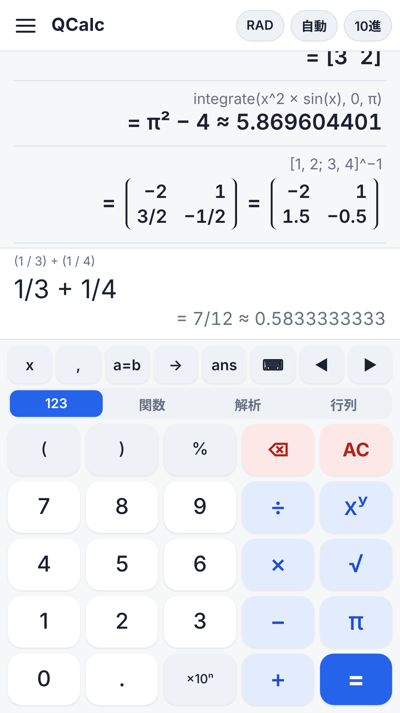
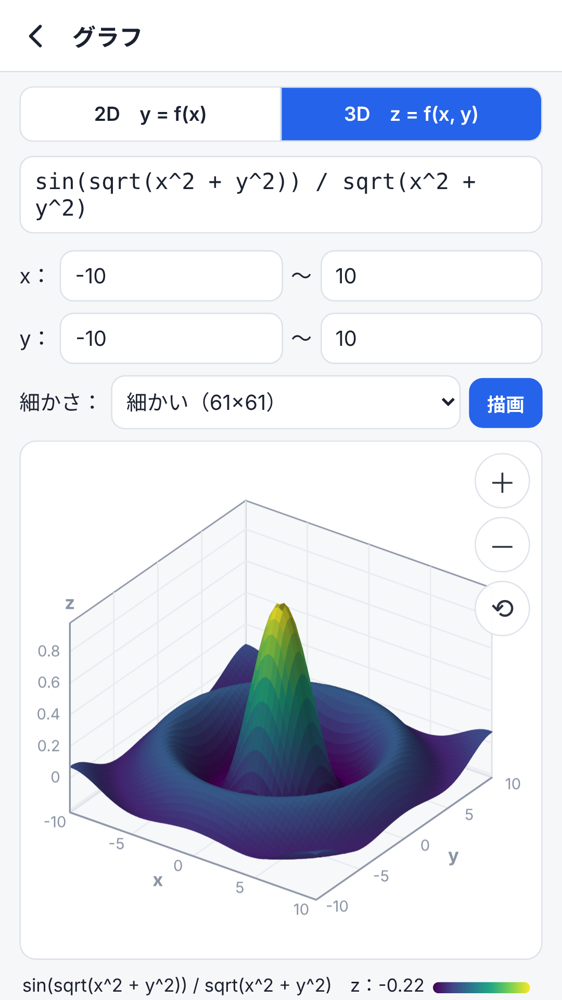
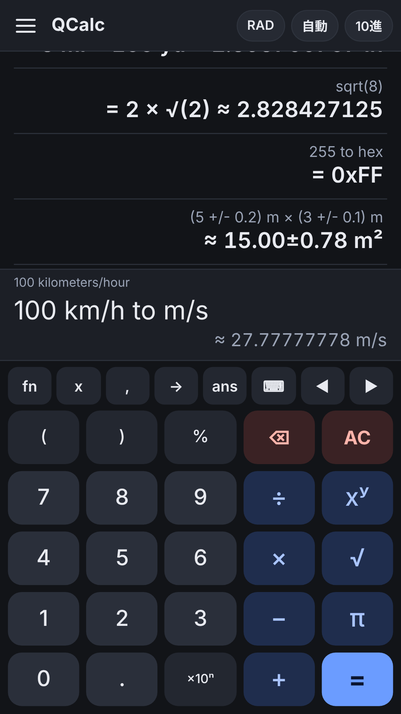

# QCalc

[English](README.md) | **日本語**

式のまま計算できる、Android 用の多機能電卓です。計算には、オープンソースの電卓 [Qalculate!](https://qalculate.github.io/) の計算エンジン **libqalculate 5.13.2** をそのまま使っています。

<p>



</p>

- `60 mph to km/h`、`100 USD to JPY`、`solve(x^2 − 5x + 6 = 0)`、`integrate(x^2 sin(x), 0, pi)` のように、式をそのまま入力して計算できます。
- 単位変換、通貨換算、方程式、微分・積分、行列、複素数、2・8・16 進数、日付、誤差の伝播、最大 200000 桁（20 万桁）の高精度計算
- キーは「123」「関数」「解析」「行列」の 4 種類。「解析」は微分・積分・極限・総和・微分方程式（`diff`、`integrate`、`limit`、`sum`、`dsolve`）、「行列」は `[1, 2; 3, 4]` の入力と行列式・逆行列・転置などのキーです。行列の結果は表の形で表示します。
- 日本の単位（坪・反・寸・尺・間・里・合・升・匁・貫）も使えます（例：`30 坪 to m²`）。libqalculate にはない単位で、QCalc が計算エンジンの起動時に追加しています。行列のトレース `trace()` も同じように追加しています。
- 2D グラフ（y = f(x)）と 3D グラフ（z = f(x, y) の曲面、指で回転・拡大）
- 式の例と使い方をアプリ内に収録（タップして試せます）。関数・単位・定数の一覧は日本語でも検索できます。
- 自分で定義する変数と関数、計算履歴、消した式や履歴を「元に戻す」、文字の大きさの変更、ダークモード
- 個人情報を集めません。広告もありません（[プライバシーポリシー](https://hiroshitsu.github.io/qcalc/privacy.html)）。
- 対応端末：Android 7.0 以降、arm64（64 ビット ARM）

QCalc は Qalculate! の公式アプリではなく、Qalculate! の開発者とは関係のない個人が作っています。

## 仕組み

- **画面**：HTML・CSS・JavaScript のページ（`app/assets/`）を WebView で表示しています。Java 側は `QalcNative` という名前の JavaScript インターフェースで呼び出します。
- **Java**（`app/src/`）：`MainActivity` が WebView を持ちます。`Engine` は計算エンジンを子プロセスとして動かし、要求ごとに制限時間を設けます。時間内に答えないエンジンは止めて、起動し直します。`RatesUpdater` は、公式の Qalculate! と同じ取得元から為替レートをダウンロードします。`StateStore` は、履歴・設定・入力中の式をアプリ専用の領域に保存します。
- **計算エンジン**（`bridge/qalc-engine.cc` と libqalculate）：zig でビルドした arm64 の静的な実行ファイルです。インストール時に Android がファイルとして取り出し、アプリから起動できるように、ネイティブライブラリ（`libqalcengine.so`）の形でアプリに入れています。アプリとエンジンは、標準入出力で 1 行に 1 件の JSON をやりとりします（`calc`、`plot`、`plot3d`、`catalog`、`define_var` などの命令）。

## 設計書・マニュアル

設計書一式（PDF）は [design/](design/) にあります。英語の概要のほかは、日本語です。

- [概要](design/00-overview.pdf)
- [1. 要件定義書](design/01-requirements.pdf)
- [2. 基本設計書](design/02-basic-design.pdf)
- [3. 詳細設計書](design/03-detailed-design.pdf)
- [4. 操作マニュアル](design/04-user-manual.pdf)
- [5. ビルド・保守マニュアル](design/05-build-and-maintenance.pdf)
- [6. テスト仕様書・結果](design/06-test-specification.pdf)
- [Design overview（英語の概要）](design/00-overview-en.pdf)

## 中身

| パス | 内容 |
| --- | --- |
| `bridge/qalc-engine.cc` | libqalculate を呼び出す小さなプログラム（1 行 1 件の JSON でアプリとやりとり） |
| `app/AndroidManifest.xml`, `app/src/` | Android 側の Java コード（WebView、エンジンの起動と監視、為替レートの取得、履歴などの保存） |
| `app/res/`, `app/res-debug/` | アプリ名、テーマ、ランチャーのアイコン（`res-debug` はテスト版の名前「QCalc (debug)」） |
| `app/assets/` | 画面（HTML / CSS / JavaScript）。`licenses.js` はアプリに組み込んだソフトウェアのライセンス文 |
| `app/jniLibs/arm64-v8a/libqalcengine.so` | ビルド済みの計算エンジン（arm64 の実行ファイル。`build-engine.sh` で作り直せます） |
| `third_party/` | エンジンに組み込んだ libqalculate・GMP・MPFR・libxml2 のソース（[説明](third_party/README.md)） |
| `fetch-sources.sh` | `third_party/` のソースを `src/` に展開 |
| `build-engine.sh` | エンジンを arm64 向けに静的ビルド（zig を使用。Android NDK は不要） |
| `build-common.sh` | `build-apk.sh` と `build-aab.sh` の共通部分（Android SDK の場所、Java のコンパイルなど） |
| `build-apk.sh` | テスト用 APK（パッケージ名 `io.github.hiroshitsu.qcalc.debug`）を作る |
| `build-aab.sh` | Google Play に出す App Bundle（`.aab`）を作り、アップロード鍵で署名する |
| `make-licenses.py` | `app/assets/licenses.js` を作る（ライブラリの版を変えたとき） |
| `version.properties` | アプリの版（スクリプトと Android Studio の両方がここから読みます） |
| `settings.gradle`, `build.gradle`, `app/build.gradle`, `gradle.properties`, `gradle/wrapper/` | Android Studio（Gradle）用の設定 |
| `keystore.properties.example` | Android Studio で release に署名するときの設定の見本 |
| `icon/` | アイコンの元（`qcalc-icon.svg`）と、`app/res` の各サイズのアイコンを作るスクリプト |
| `store/` | Google Play のストア掲載用の文章と画像 |
| `docs/` | GitHub Pages で公開するページ（紹介ページとプライバシーポリシー） |
| `design/` | 設計書一式（PDF）：概要、要件定義書、基本設計書、詳細設計書、操作マニュアル、ビルド・保守マニュアル、テスト仕様書・結果、英語の概要 |

## ビルド環境（Ubuntu 24.04 で確認）

```
sudo apt install build-essential autoconf automake libtool intltool autopoint gettext pkg-config \
  aapt dalvik-exchange zipalign apksigner openjdk-17-jdk-headless git curl xz-utils qemu-user-static
pip install ziglang==0.17.1
```

Android SDK の platform ファイルも必要です（このリポジトリには入っていません）。Android Studio の SDK Manager か `sdkmanager "platforms;android-36" "platforms;android-34"` で入れてください。スクリプトは `$ANDROID_HOME`（なければ `~/Android/Sdk`）の下を探します。別の場所にあるときは `ANDROID_JAR`（API 36 の android.jar、Java のコンパイル用）と `AAPT2_JAR`（API 34 の android.jar、Ubuntu の aapt2 は API 35 以降を読めないため）で指定します。

アイコンを作り直すとき（`icon/make-icons.sh`）だけ、`librsvg2-bin` と `imagemagick` も必要です。

## ビルド

計算エンジンはビルド済みのものが `app/jniLibs` に入っているので、画面や Java だけを直すときはエンジンのビルドは不要です。

```
./fetch-sources.sh     # third_party/ のソースを src/ に展開
./build-engine.sh      # libqalculate などを arm64 向けにビルドし、エンジンを app/jniLibs にコピー
./build-apk.sh         # テスト用 APK：out/QCalc-<版>-debug.apk
./build-aab.sh         # Google Play 用：out/QCalc-<版>.aab
```

- テスト用 APK は `io.github.hiroshitsu.qcalc.debug`・「QCalc (debug)」という別アプリとして入るので、Google Play 版と並べて使えます。署名にはテスト用の鍵 `signing/qcalc-debug.keystore`（初回に自動で作成）を使います。
- Google Play に新しい版を出すときは、`version.properties` の `VERSION_CODE` を必ず前より大きくしてください。

エンジンの動作確認（任意。PC 上で arm64 を模擬実行）：

```
echo '{"id":1,"cmd":"calc","expr":"integrate(x^2 sin(x), 0, pi)"}' | QALCULATE_USER_DIR=/tmp/q qemu-aarch64-static bridge/qalc-engine
echo '{"id":2,"cmd":"plot3d","exprs":["sin(x) cos(y)"],"nx":5,"ny":5}' | QALCULATE_USER_DIR=/tmp/q qemu-aarch64-static bridge/qalc-engine
```

## libqalculate との違い

libqalculate のソースは変更していません（`third_party/` のものをそのままビルドします）。計算の結果は公式の `qalc` と同じです。次の 3 点だけ、`bridge/qalc-engine.cc` が実行中の計算エンジンに足しています。

- 日本の単位（坪・反・寸・尺・間・里・合・升・匁・貫）
- 行列のトレース `trace()`（libqalculate には `det()` や `rk()` はありますが、トレースがありません）
- libqalculate 5.13.2 では、無限大を端にもつ定積分（例：`integrate(e^(−x^2), −∞, ∞)`）を一度計算すると、そのあとの警告やエラー（「ゼロで割っています」など）が表示されなくなります（`qalc` でも同じです）。QCalc では、計算のたびにこの状態を元に戻しているので、警告は表示されます。

## 署名と Google Play

QCalc は Google Play アプリ署名を使います。アプリに署名する鍵は Google が管理し、開発者は **アップロード鍵** で署名した `.aab` を Play Console にアップロードします。

- `build-aab.sh` は `signing/qcalc-upload.jks`（別名 `upload`）で署名します。パスワードは環境変数 `QCALC_UPLOAD_PASS` か、ファイル `signing/qcalc-upload.pass` から読みます。
- **アップロード鍵とパスワードは公開しないでください**（`signing/` は `.gitignore` で除外しています）。なくした・漏れたときは、Play Console からアップロード鍵の再設定を申請できます。
- `build-aab.sh` は App Bundle の設定（BundleConfig）で「ネイティブライブラリを圧縮しない」最適化を無効にしています。計算エンジンはライブラリではなくプログラムとして起動するため、インストール時にファイルとして取り出される必要があるからです（`android:extractNativeLibs="true"`）。

## Android Studio で開く

1. Android Studio で「Open」を選び、このフォルダ（`settings.gradle` があるフォルダ）を開きます。Android Gradle Plugin 8.11.1、Gradle 8.13、compileSdk 36 を使います。
2. スマホを USB デバッグでつないで実行（▶）すると、デバッグ版（`io.github.hiroshitsu.qcalc.debug`）が入ります。
3. Google Play 用には、Build メニューの「Generate Signed App Bundle or APK…」で Android App Bundle を選び、アップロード鍵を指定して release を作ります。`keystore.properties.example` を `keystore.properties` にコピーして書き込んでおくと、release に自動で署名されます（このファイルも公開しないでください）。

注意：

- Android Studio は計算エンジンを作りません。`app/jniLibs/arm64-v8a/libqalcengine.so` をそのまま入れます。`bridge/qalc-engine.cc` や libqalculate を変えたときは、Linux（Windows では WSL）で `./build-engine.sh` を実行してください。
- Gradle の設定は、Gradle と Android SDK をダウンロードできない環境で作ったため、Android Studio でのビルドはまだ確かめていません。Gradle で作った `.aab` を使うときは、`bundletool dump config --bundle=app-release.aab` で `uncompressNativeLibraries` が有効になっていない（`"enabled": true` がない）ことを確かめてください。
- `gradlew` は入っていません（Android Studio では不要です）。

## ライセンス

QCalc は GNU General Public License v2 以降（[LICENSE](LICENSE)）のフリーソフトウェアです。libqalculate も GPL v2 以降です。

計算エンジンには、GMP（LGPL v3 以降 または GPL v2 以降）、MPFR（LGPL v3 以降）、libxml2（MIT）、zig に同梱の musl libc（MIT）、LLVM libc++ / libc++abi / libunwind（Apache License 2.0 with LLVM Exceptions）、compiler_rt（MIT）も組み込んでいます。MPFR が LGPL v3 以降のため、エンジン全体は GNU GPL v3 以降の条件で配布しています。これらのソースは `third_party/` にあり、ライセンスの全文はアプリの「このアプリについて」→「オープンソースライセンス」で読めます。

アイコンは QCalc のために作ったもので、Qalculate! のアイコンとは別のものです。
