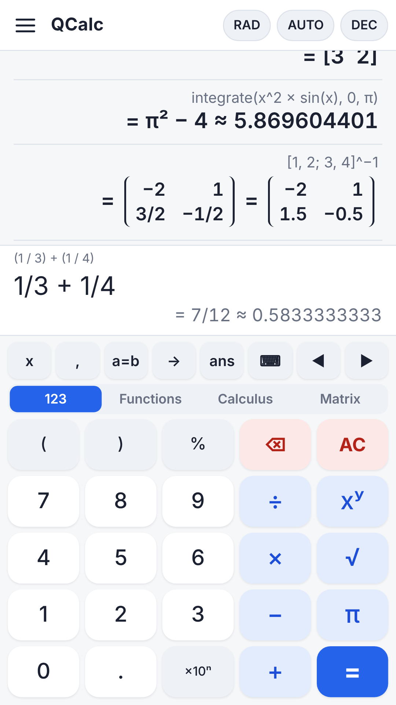
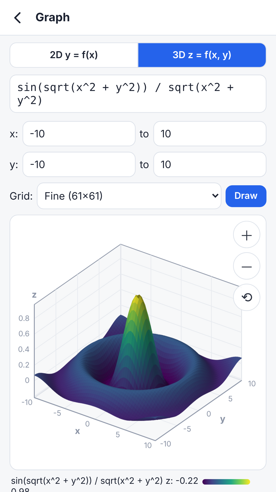
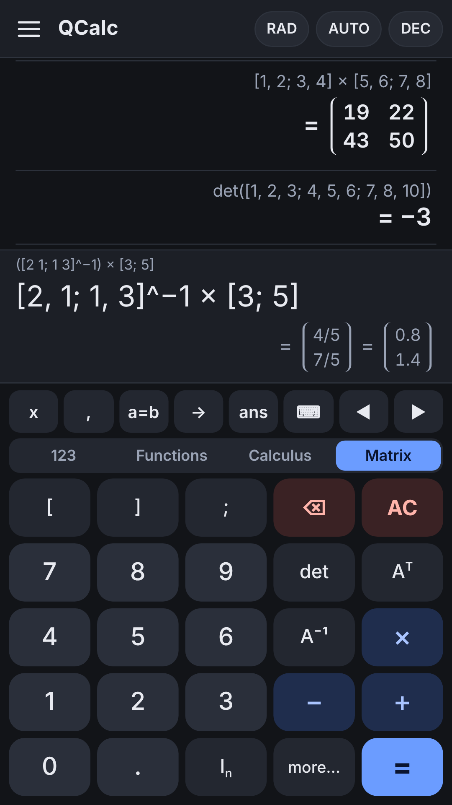

# QCalc

**English** | [日本語](README.ja.md)

QCalc is a multi-function calculator for Android. You type an expression the way you would write it, and QCalc evaluates it with **libqalculate 5.13.2**, the calculation engine of the open-source calculator [Qalculate!](https://qalculate.github.io/), used without modification.

The app is in English and Japanese: it starts in English, and "Language / 言語" in the menu switches it to Japanese. QCalc is not an official Qalculate! app; it is made by an individual developer who is not affiliated with the Qalculate! project.

<p>



</p>

## Features

- Type expressions such as `60 mph to km/h`, `100 USD to JPY`, `solve(x^2 − 5x + 6 = 0)` or `integrate(x^2 sin(x), 0, pi)`; the result is shown while you type.
- Suggestions below the input field: after `to`, the units the value can be converted to (`5 km to` offers m, mi, ft, …; a number without a unit offers `hex`, `fraction`, `factors`, …), and with the phone keyboard the names of functions, units and constants that begin with the letters typed
- Unit conversion, currency conversion, equations, derivatives and integrals, matrices, complex numbers, binary, octal and hexadecimal numbers, dates, uncertainty propagation, and high-precision arithmetic with up to 200,000 digits
- Four keypads: 123, Functions, Calculus (`diff`, `integrate`, `limit`, `sum`, `dsolve`) and Matrix (entering `[1, 2; 3, 4]`, determinant, inverse, transpose and more). Matrix results are shown as tables.
- Traditional Japanese units (坪 tsubo, 反 tan, 寸 sun, 尺 shaku, 間 ken, 里 ri, 合 gō, 升 shō, 匁 monme, 貫 kan), for example `30 坪 to m²`. libqalculate does not have these units; QCalc adds them when the engine starts, together with the matrix trace `trace()`.
- 2D graphs (y = f(x)) and 3D graphs (surfaces z = f(x, y) that you rotate and zoom with your fingers)
- Built-in examples and instructions (tap an example to try it). The lists of functions, units and constants can be searched (in Japanese too).
- User-defined variables and functions, calculation history, undo for a cleared expression or a deleted history item, three text sizes, seven color themes, light or dark display (the phone's setting or your own choice)
- Export of the history as a CSV file (UTF-8 with a byte order mark, so that Excel reads it correctly)
- No personal data is collected, and there are no ads ([privacy policy](https://hiroshitsu.github.io/qcalc/privacy.html)).
- Requirements: Android 7.0 or later on a 64-bit ARM (arm64) device

## QCalc Pro

QCalc Pro is a one-time purchase in Google Play (the one-time product `qcalc_pro`) that unlocks a precision above 1000 digits, 3D graphs, the color themes, exporting the history, and the Pro features of later versions. Everything else stays free.

- The purchase is made with the Google Play Billing Library (`app/src-billing/PlayBilling.java`). It is built only with Gradle and `qcalc.billing=true` (see `app/build.gradle`); `build-apk.sh` and `build-aab.sh` leave it out.
- **A build without the library cannot sell Pro, so it locks nothing**: every feature is free, as in the versions before Pro. The test build (`.debug`) has Pro unlocked, and the Pro panel can lock it to show the app as without Pro.
- People who used QCalc before Pro began keep the Pro features for free (`Pro.java`).

## How it works

- **User interface**: an HTML/CSS/JavaScript page (`app/assets/`) shown in a WebView. It calls the Java side through a JavaScript interface named `QalcNative`.
- **Java** (`app/src/`): `MainActivity` hosts the WebView. `Engine` runs the calculation engine as a child process and gives every request a deadline; an engine that does not answer in time is killed and started again. `RatesUpdater` downloads exchange rates from the same sources the official Qalculate! uses. `StateStore` saves the history, the settings and the expression being typed in the app's private storage. `Pro` keeps the state of QCalc Pro.
- **Calculation engine** (`bridge/qalc-engine.cc` and libqalculate): a static arm64 executable built with zig. It is packaged as a native library (`libqalcengine.so`) so that Android extracts it at install time and the app can start it. The app and the engine exchange one JSON object per line over standard input and output (commands such as `calc`, `plot`, `plot3d`, `catalog` and `define_var`).

## Design documents

The design document set is in [design/](design/), in English and in Japanese with the same content (PDF, A4). Start with the overview.

| Document | English | Japanese |
| --- | --- | --- |
| Overview | [00-overview-en.pdf](design/00-overview-en.pdf) | [00-overview.pdf](design/00-overview.pdf) (概要) |
| 1. Requirements definition | [01-requirements-en.pdf](design/01-requirements-en.pdf) | [01-requirements.pdf](design/01-requirements.pdf) (要件定義書) |
| 2. Basic design | [02-basic-design-en.pdf](design/02-basic-design-en.pdf) | [02-basic-design.pdf](design/02-basic-design.pdf) (基本設計書) |
| 3. Detailed design | [03-detailed-design-en.pdf](design/03-detailed-design-en.pdf) | [03-detailed-design.pdf](design/03-detailed-design.pdf) (詳細設計書) |
| 4. User manual | [04-user-manual-en.pdf](design/04-user-manual-en.pdf) | [04-user-manual.pdf](design/04-user-manual.pdf) (操作マニュアル) |
| 5. Build and maintenance manual | [05-build-and-maintenance-en.pdf](design/05-build-and-maintenance-en.pdf) | [05-build-and-maintenance.pdf](design/05-build-and-maintenance.pdf) (ビルド・保守マニュアル) |
| 6. Test specification and results | [06-test-specification-en.pdf](design/06-test-specification-en.pdf) | [06-test-specification.pdf](design/06-test-specification.pdf) (テスト仕様書・結果) |

## Repository contents

| Path | Contents |
| --- | --- |
| `bridge/qalc-engine.cc` | A small program that calls libqalculate (it talks to the app with one JSON object per line) |
| `app/AndroidManifest.xml`, `app/src/` | The Java code of the app (WebView, starting and supervising the engine, downloading exchange rates, saving the history and settings, QCalc Pro) |
| `app/src-billing/` | The purchase of QCalc Pro with the Google Play Billing Library (only in Gradle builds with `qcalc.billing=true`) |
| `app/res/`, `app/res-debug/` | App name, theme and launcher icons (`res-debug` holds the name of the test build, "QCalc (debug)") |
| `app/assets/` | The user interface (HTML / CSS / JavaScript). `licenses.js` holds the license texts of the bundled software |
| `app/jniLibs/arm64-v8a/libqalcengine.so` | The prebuilt calculation engine (an arm64 executable; `build-engine.sh` rebuilds it) |
| `third_party/` | Source archives of libqalculate, GMP, MPFR and libxml2, which are built into the engine ([details](third_party/README.md)) |
| `fetch-sources.sh` | Extracts the sources in `third_party/` into `src/` |
| `build-engine.sh` | Builds the engine statically for arm64 (with zig; the Android NDK is not needed) |
| `build-common.sh` | The parts shared by `build-apk.sh` and `build-aab.sh` (location of the Android SDK, Java compilation and so on) |
| `build-apk.sh` | Builds the test APK (package name `io.github.hiroshitsu.qcalc.debug`) |
| `build-aab.sh` | Builds the App Bundle (`.aab`) for Google Play and signs it with the upload key |
| `make-licenses.py` | Generates `app/assets/licenses.js` (run it after changing the version of a library) |
| `version.properties` | The app version (read by the scripts and by Android Studio) |
| `settings.gradle`, `build.gradle`, `app/build.gradle`, `gradle.properties`, `gradle/wrapper/` | Settings for Android Studio (Gradle) |
| `keystore.properties.example` | A template for signing release builds in Android Studio |
| `icon/` | The icon source (`qcalc-icon.svg`) and a script that makes the icons of every size in `app/res` |
| `store/` | Texts (`listing-en.md` in English, `listing-ja.md` in Japanese) and images (`screenshots-en/`, `screenshots/`) for the Google Play store listing |
| `docs/` | The pages published with GitHub Pages (the app's home page and the privacy policy) |
| `design/` | The design document set in English and Japanese (PDF) |

## Build environment (tested on Ubuntu 24.04)

```
sudo apt install build-essential autoconf automake libtool intltool autopoint gettext pkg-config \
  aapt dalvik-exchange zipalign apksigner openjdk-17-jdk-headless git curl xz-utils qemu-user-static
pip install ziglang==0.17.1
```

The Android SDK platform files are also needed (they are not in this repository). Install them with the SDK Manager of Android Studio or with `sdkmanager "platforms;android-36" "platforms;android-34"`. The scripts look under `$ANDROID_HOME` (or `~/Android/Sdk` when it is not set). If the files are somewhere else, set `ANDROID_JAR` (the android.jar of API 36, used to compile the Java code) and `AAPT2_JAR` (the android.jar of API 34, because the aapt2 of Ubuntu cannot read API 35 or later).

`librsvg2-bin` and `imagemagick` are needed only to rebuild the icons (`icon/make-icons.sh`).

## Build

The prebuilt engine is already in `app/jniLibs`, so you do not need to build the engine when you change only the user interface or the Java code.

```
./fetch-sources.sh     # extract the sources in third_party/ into src/
./build-engine.sh      # build libqalculate and the rest for arm64 and copy the engine to app/jniLibs
./build-apk.sh         # test APK: out/QCalc-<version>-debug.apk
./build-aab.sh         # for Google Play: out/QCalc-<version>.aab
```

- The test APK installs as a separate app, `io.github.hiroshitsu.qcalc.debug` ("QCalc (debug)"), so it can be used next to the Google Play version. It is signed with a test key, `signing/qcalc-debug.keystore`, which is created on the first build.
- Before publishing a new version on Google Play, always make `VERSION_CODE` in `version.properties` larger than before.

To try the engine on a PC (optional; it runs the arm64 program under emulation):

```
echo '{"id":1,"cmd":"calc","expr":"integrate(x^2 sin(x), 0, pi)"}' | QALCULATE_USER_DIR=/tmp/q qemu-aarch64-static bridge/qalc-engine
echo '{"id":2,"cmd":"plot3d","exprs":["sin(x) cos(y)"],"nx":5,"ny":5}' | QALCULATE_USER_DIR=/tmp/q qemu-aarch64-static bridge/qalc-engine
```

## Differences from libqalculate

The source of libqalculate is not changed (the archive in `third_party/` is built as it is), so the results are the same as those of the official `qalc`. `bridge/qalc-engine.cc` adds only these three things to the running engine:

- Traditional Japanese units (坪, 反, 寸, 尺, 間, 里, 合, 升, 匁, 貫)
- The matrix trace `trace()` (libqalculate has `det()` and `rk()`, but no trace)
- In libqalculate 5.13.2, after a definite integral with an infinite bound (for example `integrate(e^(−x^2), −∞, ∞)`) has been calculated, later warnings and errors (such as division by zero) are no longer shown (`qalc` behaves the same way). QCalc resets this state for every calculation, so the warnings are shown.

## Signing and Google Play

QCalc uses Play App Signing: Google manages the key that signs the app, and the developer uploads `.aab` files signed with an **upload key** to the Play Console.

- `build-aab.sh` signs with `signing/qcalc-upload.jks` (alias `upload`). The password is read from the environment variable `QCALC_UPLOAD_PASS` or from the file `signing/qcalc-upload.pass`.
- **Never publish the upload key or its password** (`signing/` is excluded in `.gitignore`). If the key is lost or leaked, you can request an upload key reset in the Play Console.
- `build-aab.sh` turns off the "uncompressed native libraries" optimization in the bundle configuration (BundleConfig). The engine is started as a program, not loaded as a library, so it must be extracted as a file at install time (`android:extractNativeLibs="true"`).

## Opening the project in Android Studio

1. In Android Studio, choose "Open" and open this folder (the one that contains `settings.gradle`). The project uses Android Gradle Plugin 8.11.1, Gradle 8.13 and compileSdk 36.
2. Connect a phone with USB debugging and run the app (▶) to install the debug build (`io.github.hiroshitsu.qcalc.debug`).
3. For Google Play, choose "Generate Signed App Bundle or APK…" in the Build menu, select Android App Bundle, and give the upload key to build the release. If you copy `keystore.properties.example` to `keystore.properties` and fill it in, release builds are signed automatically (do not publish this file either).

Notes:

- Android Studio does not build the engine; it packages `app/jniLibs/arm64-v8a/libqalcengine.so` as it is. After changing `bridge/qalc-engine.cc` or libqalculate, run `./build-engine.sh` on Linux (WSL on Windows).
- The Gradle files were written in an environment that could not download Gradle or the Android SDK, so the Android Studio build has not been tested yet. If you use an `.aab` built with Gradle, check with `bundletool dump config --bundle=app-release.aab` that `uncompressNativeLibraries` is not enabled (there is no `"enabled": true`).
- `gradlew` is not included (Android Studio does not need it).

## License

QCalc is free software under the GNU General Public License, version 2 or later ([LICENSE](LICENSE)). libqalculate is also licensed under GPL v2 or later.

As a special exception, the copyright holder of QCalc's own code (everything in this repository that is not in `third_party/`) gives permission to link it with the Google Play Billing Library and the libraries it needs, and to distribute the result, without the GPL applying to those libraries. Any other software that is GPL-licensed, such as libqalculate, is not covered by this exception; QCalc's app code does not link libqalculate, which runs as a separate program (the engine).

The engine also contains GMP (LGPL v3 or later, or GPL v2 or later), MPFR (LGPL v3 or later), libxml2 (MIT), the musl libc bundled with zig (MIT), LLVM libc++ / libc++abi / libunwind (Apache License 2.0 with LLVM Exceptions) and compiler_rt (MIT). Because MPFR is LGPL v3 or later, the engine as a whole is distributed under the terms of the GNU GPL v3 or later. The sources are in `third_party/`, and the full license texts can be read in the app under "About this app" → "Open source licenses".

The icon was made for QCalc and is different from the Qalculate! icon.
